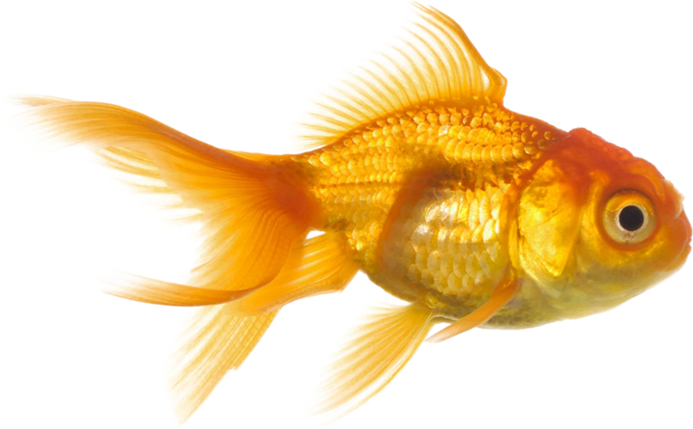

# 虚拟桌面鱼缸 / Virtual Desktop Aquarium

一个**零依赖**的单文件网页版鱼缸：`index.html` 内联全部 HTML/CSS/JS，用 Canvas 2D 渲染，
既可作为 **Windows 桌面壁纸**运行在桌面图标之下，也可当普通网页打开互动。



## 特性

- **真实感鱼体渲染**：素材是透明底实拍鱼（PCA 主轴对齐、统一头朝右），按"曲率行波"逐列变形，
  游动时身体连续 S 形摆动，而非整张图旋转。
- **伪 3D 纵深**：每条鱼有独立深度 `z`，决定尺寸（0.54×~1.40×）、景深虚化（两级预模糊）、
  水色雾化与遮挡顺序；周期性"转身面向镜头"，头部逐渐变大。
- **9 种观赏鱼**：琉金金鱼、红琉金、七彩神仙、小丑鱼、黄高鳍、蓝宝石鱼、虎皮鱼、红鳍笛鲷、紫红笛鲷。
- **水下氛围**：光柱、水面焦散（沙面 + 水中）、气泡、浮游颗粒、水面波纹、玻璃暗角与反光。
- **互动**：点击投食、晃动鼠标逗鱼、鱼吃到食物会冒涟漪。
- **壁纸模式**：自动投食（30s）与随机逗鱼（19s），无鼠标事件时鱼会自行冲刺。

## 目录结构

```
index.html                 主程序（单文件，内联 JS）
aquarium-standalone.html   单文件版：素材全部内联为 base64，可直接双击打开
build_standalone.js        生成单文件版的脚本
sprites/                   w0..w8.png 鱼素材 + bg_forest.jpg 背景
WallLib.cs                 壁纸嵌入工具源码（SetParent 到 WorkerW + 启动 Chrome）
matte*.cs                  素材处理工具（抠图羽化、去杂点、PCA 主轴对齐）
cap8.ps1                   PrintWindow 截屏脚本（调试用）
启动鱼缸.vbs / 桌面壁纸.vbs / 还原为窗口.vbs   快捷入口
```

## 使用

**直接打开**：双击 `index.html`（互动模式，可点击、可逗鱼）。

**单文件版**：`aquarium-standalone.html` 把背景和 9 种鱼全部内联成 base64（约 5.7 MB），
单个文件即可双击打开，**不依赖 `sprites/` 目录**，可以随便拷贝或上传到任意静态托管。
改动素材后重新生成：`node build_standalone.js`。

**设为桌面壁纸**：运行 `AquariumWallpaper.exe`（或 `桌面壁纸.vbs`）。
它用 Chrome 以 app 模式打开 `index.html?wallpaper`，再把窗口挂到桌面的 `WorkerW` 上。

```powershell
# 编译壁纸工具（.exe 为编译产物，未入库）
C:\Windows\Microsoft.NET\Framework64\v4.0.30319\csc.exe /nologo /target:winexe WallLib.cs

.\AquariumWallpaper.exe start user   # 启动并嵌入桌面
.\AquariumWallpaper.exe restore      # 还原为普通窗口
```

## 调试参数

- `index.html?fps`：左上角显示帧率
- `index.html?dbg`：显示鱼的数量、坐标与朝向

## 素材来源

鱼与背景素材来自 [pngimg.com](https://pngimg.com)（CC BY-NC 4.0，**仅限非商业用途**）。
商业场景请自行替换素材。

## 已知限制

- 壁纸窗口挂到 `WorkerW` 后收不到鼠标事件，因此壁纸模式以自动投食/自动逗鱼代替手动互动。
- 壁纸窗口在部分系统上会被系统在数分钟后关闭，需要重新挂载。
- 鱼绘制在桌面图标**下层**，游到图标后面会被遮住。
